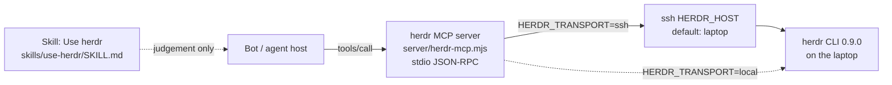

# herdr Agent Plugin

Lets bots drive [herdr](https://herdr.dev) (a terminal multiplexer for coding agents) on the user's laptop safely.

It has two parts:

1. A **zero-dependency** Node stdio MCP server (`server/herdr-mcp.mjs`, Node built-ins only) that turns herdr's mechanical rules into code — **11 tools**.
2. A lean skill (`skills/use-herdr/SKILL.md`) that keeps only the judgement calls that code cannot make.

Verified against **herdr 0.9.0** (protocol 22). Does **not** publish to any marketplace; this repo is the plugin source itself.

---

## Architecture



Transport defaults: `HERDR_TRANSPORT=ssh`, `HERDR_HOST=laptop`. The host value must be a working ssh destination — either an ssh `Host` alias or `user@tailnet-ip`. Cursor does **not** expand `${PLUGIN_ROOT}`; `mcp.json` therefore sets `"cwd": "./"`.

---

## Layout

| Path | Role |
|---|---|
| `plugin.json` | Agent Plugins manifest (schema 1.0.0) |
| `mcp.json` | stdio server registration; **`cwd` is `./`** (Cursor does not expand `${PLUGIN_ROOT}`) |
| `server/herdr-mcp.mjs` | Data shapes, transport, pure parsers/policy, 11 tools, JSON-RPC loop |
| `skills/use-herdr/SKILL.md` | "Use herdr" judgement rules |
| `test/server.test.mjs` | `node --test` suite (fake herdr on `PATH`) — **13 tests** |
| `test/bin/herdr` | Fake herdr that mirrors real 0.9.0 JSON |
| `scripts/handshake.mjs` | Pipes `initialize` + `tools/list` + `tools/call` into the server |
| `scripts/live-proof.mjs` | Rerunnable live proof in a throwaway `tinkabot-test` workspace |
| `docs/NOTES.md` | Build notes (field quirks, transport findings) |
| `docs/samples/`, `docs/proof/` | Captured herdr output and proof logs (**gitignored** — host/session details) |

---

## Configuration (env on the MCP server)

| Variable | Default | Meaning |
|---|---|---|
| `HERDR_TRANSPORT` | `ssh` | `local` runs `herdr` directly on this host; `ssh` shells out via `ssh $HERDR_HOST` |
| `HERDR_HOST` | `laptop` | ssh destination. Needs an ssh `Host` alias **or** `user@tailnet-ip` (MagicDNS often unavailable when `--accept-dns=false`) |
| `HERDR_REMOTE_PATH` | `/opt/homebrew/bin:/usr/local/bin:$HOME/.local/bin:$HOME/.cargo/bin` | Prepended to `PATH` on the remote side (non-login zsh lacks Homebrew) |
| `HERDR_BIN` | `herdr` | Binary name or path |
| `HERDR_PLUGIN_STATE` | `~/.local/state/herdr-plugin/owned.json` | Ownership record of workspaces/tabs this plugin created; keyed per host |

Example `mcp.json` (as shipped):

```json
{
  "mcpServers": {
    "herdr": {
      "type": "stdio",
      "command": "node",
      "args": ["server/herdr-mcp.mjs"],
      "cwd": "./",
      "env": {
        "HERDR_TRANSPORT": "ssh",
        "HERDR_HOST": "laptop"
      }
    }
  }
}
```

---

## Tools

The plugin deliberately exposes **no** bare `herdr`, no send-keys, no `--group`, no pane split/move, and no dialog answering.

| Tool | Purpose | Key guardrails |
|---|---|---|
| `herdr_snapshot` | One call: every workspace → tabs → agents, plus `agents_by_state` and `owned` ids | Start here; use returned ids and agent `target` values |
| `herdr_read_agent` | Read what an agent is showing | Address by `target` (name or pane id); kinds rejected; picks visible screen while working/blocked, `recent-unwrapped` when idle |
| `herdr_prompt_agent` | Send a prompt; wait until settle; optional leading `/skill` | Kinds rejected; on blocked/stalled/timeout returns the screen; identical resend refused unless `confirm_resend: true` |
| `herdr_run` | Run one shell command in a **terminal** pane; return **real** exit code + trimmed output (≤200 lines) | Refuses agent panes; one-line commands only; exit-marker wrapper (see flow below) |
| `herdr_create_workspace` | Get-or-create a workspace (one per repository) | `--no-focus`; returns existing match by label or checkout path |
| `herdr_create_tab` | Get-or-create a tab | `--no-focus`; same label → existing tab; **refuses an 8th tab** (`MAX_TABS = 7`) |
| `herdr_create_worktree` | Get-or-create a git worktree + its own workspace (branch per bot) | `--no-focus`; re-opens existing branch instead of duplicating |
| `herdr_start_agent` | Start a named coding agent in an idle shell pane | Name `[a-z][a-z0-9_-]{0,31}`; kinds are not names; pane must be idle shell |
| `herdr_close` | Close a workspace, tab, or worktree | **Only** ids this plugin created (ownership file); never `--group` |
| `herdr_rename_tab` | Rename a tab | Tell the user afterwards (skill judgement) |
| `herdr_notify` | Show a toast on the herdr client | Optional `sound`: `none` \| `done` \| `request` |

---

## Rules in code vs judgement in the skill

Mechanical rules live in the MCP server so bots cannot "forget" them. Judgement stays in `skills/use-herdr/SKILL.md`.

| Concern | Encoded in tools (code) | Left to skill (judgement) |
|---|---|---|
| Addressing | Reject kinds as targets/names; require name or pane id | Choose *which* agent; learn roles from tab title / transcript / ask |
| Focus | Always pass `--no-focus` on create/open | Prefer working in the user's visible session when they point you at it |
| Tab cap | Refuse 8th tab (`MAX_TABS = 7`) | Ask before adding/renaming user tabs; keep a lasting role record |
| Prompts | No blind resend after blocked/stalled/timeout without `confirm_resend` | Decide from the screen whether a resend is right; never answer another agent's dialog |
| Shell runs | Real exit codes via exit marker; refuse agent panes & multi-line cmds | Write results to files when a settled prompt isn't proof enough |
| Ownership | `herdr_close` only closes plugin-owned ids; no `--group` | Never close the user's tabs/workspaces; ask before structural changes |
| Worktrees | Get-or-create by branch; one workspace per worktree | One worktree per bot; merge into sensible PRs (not one giant / not one tiny per tree) |
| Transport | Structured `transport_unreachable` / `herdr_not_found` with hints | Bring up Tailscale / fix `HERDR_HOST` when the hint says so |
| Status watch | Snapshot groups `waiting_for_input` / `working` / `idle` / `unknown` | Report state unprompted; `herdr_notify` when the user is needed |

---

## Agent status groups

herdr 0.9.0 exposes `agent_status` values; the snapshot rolls them into four groups. **There is no `errored` state.**

| Snapshot group | Source `agent_status` | Meaning |
|---|---|---|
| `waiting_for_input` | `blocked` | Approval / question dialog — show the owner; do not answer it |
| `working` | `working` | Agent is busy; read the visible screen, wait before full history |
| `idle` | `idle`, `done` | Settled; `herdr_read_agent` uses recent-unwrapped reply |
| `unknown` | anything else / missing | Treat cautiously; re-snapshot |

Unnamed agents are common in 0.9.0 (`name` absent). Address them by `target` (= pane id when unnamed). Snapshot adds a warning when agents have no name.

---

## Data shapes (herdr 0.9.0 quirks)

Wire envelope from the CLI:

| Outcome | Shape |
|---|---|
| Success | `{ id: "cli:<group>:<verb>", result: { type: "<kind>", ... } }` |
| Error | `{ id, error: { code, message } }` (process exit 1) |
| Usage | Plain `usage: ...` text (exit 2) |

Domain ids use **`workspace_id` / `tab_id` / `pane_id`** (not a bare `id`). Agent kind is field **`agent`**; status is **`agent_status`**.

| Shape | Key fields the MCP returns |
|---|---|
| `Workspace` | `id` ← `workspace_id`, `label`, `number`, `tab_count`, `status`, `focused`, `repo`, `checkout_path`, `tabs[]` |
| `Tab` | `id` ← `tab_id`, `workspace_id`, `label`, `number`, `pane_count`, `status`, `focused`, `agents[]` |
| `Agent` | `target` (name \|\| pane_id), `name` (often `null`), `kind` ← `agent`, `status` ← `agent_status`, `pane_id`, `tab_id`, `workspace_id`, `title`, `cwd` |
| `CommandResult` | `exit_code`, `timed_out`, `output`, `output_lines`, `truncated` |
| `Snapshot` | `host`, `workspaces[]`, `agents_by_state`, `warnings[]`, `owned[]` |

---

## `herdr_run` exit-marker flow

herdr's `pane run` prints nothing on success, so the tool wraps the command with a unique exit marker, waits for it, then parses the real exit code.

```mermaid
sequenceDiagram
  participant Bot
  participant MCP as herdr_run
  participant Herdr as herdr (laptop)

  Bot->>MCP: herdr_run(pane, command)
  MCP->>MCP: Refuse if pane hosts an agent<br/>or command is multi-line
  MCP->>MCP: wrap: cmd; printf '__HERDR_EXIT_tok:N__' $?
  MCP->>Herdr: pane run (wrapped line)
  MCP->>Herdr: pane wait-output --regex __HERDR_EXIT_tok:[0-9]+__
  alt marker matched
    Herdr-->>MCP: output_matched + recent text
    MCP->>MCP: Parse exit code from marker<br/>Trim output to ≤200 lines
    MCP-->>Bot: { exit_code, output, timed_out: false }
  else timeout
    Herdr-->>MCP: error code timeout
    MCP->>Herdr: pane read --source visible
    MCP-->>Bot: { exit_code: null, timed_out: true, output: visible, hint }
  end
```

---

## Verify

| Command | What it proves |
|---|---|
| `npm test` | **13** behaviour tests against the fake herdr (`test/bin/herdr`) |
| `HERDR_HOST=user@tailnet-ip node scripts/handshake.mjs` | Live stdio handshake: `initialize` → `tools/list` → `tools/call` |
| `HERDR_HOST=user@tailnet-ip node scripts/live-proof.mjs` | End-to-end against real herdr; creates/closes only `tinkabot-test` |

```bash
npm test
HERDR_HOST=user@tailnet-ip node scripts/handshake.mjs
HERDR_HOST=user@tailnet-ip node scripts/live-proof.mjs
```

---

## What this plugin will not do

| Absent on purpose | Why |
|---|---|
| Bare `herdr` / shell passthrough | Keeps the surface small and policy-enforced |
| Send-keys / dialog answers | Another agent's approval UI belongs to its owner |
| `--group` close | Would close other people's linked worktrees |
| Pane split / move | Out of scope; bots should not rearrange the user's layout |
| Marketplace publish | This repository is the distribution; install as an Agent Plugin from source |

---

## Licence

MIT — see `plugin.json` / `package.json`. Author: Goddy Bush.
